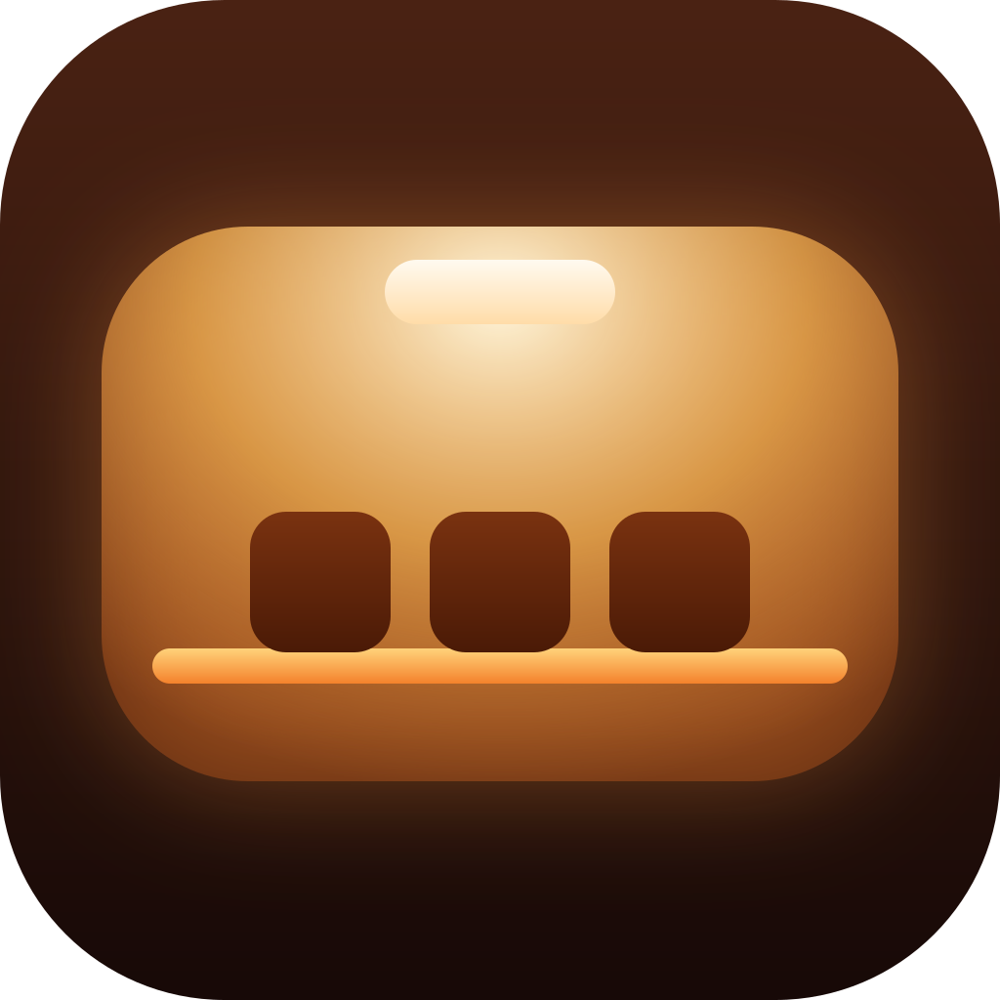
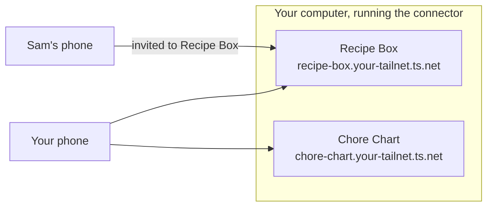

<p align="center">
  
</p>

<h1 align="center">Ovenlight</h1>

<p align="center">
  <strong>Cooking up apps with AI? Serve them to the people you made them for, and no one else.</strong><br>
  Your web apps run on your own computer, stay off the public internet and open on your phone, behind Face&nbsp;ID or your fingerprint.
</p>

<p align="center">
  <a href="https://apps.apple.com/app/id6817561066"></a>
  <a href="https://play.google.com/store/apps/details?id=com.snowyghost.ovenlight"></a><br>
  <sub>Got an invite? Install Ovenlight, then open your invite link again. Here's
  <a href="https://ovenlight.app/privacy#inviter">what the person who invited you sees</a>.</sub>
</p>

<p align="center">
  <a href="#get-started">Get&nbsp;started</a> ·
  <a href="#with-a-coding-agent">With&nbsp;your&nbsp;coding&nbsp;agent</a> ·
  <a href="#share-an-app">Share&nbsp;an&nbsp;app</a> ·
  <a href="#security">Security</a> ·
  <a href="https://ovenlight.app">ovenlight.app</a>
</p>

<p align="center">
  
</p>

I've seen people use coding agents to build incredible things that make life better and
work easier. Maybe yours is a small web app for your family, your garden or your book club.
I made Ovenlight so you'd have an easy way to share it with the people who'd benefit. It
puts the app on your phone and on the phone of anyone you invite, and it opens wherever
the phone is online, at home or away.

Your computer is the server. The app and its data stay on it and off the public internet,
and your apps open while it's on and awake. It can be your laptop or a computer at home
that stays on. If you can't keep one at home, [a server you rent](#where-your-apps-run)
works too. You install Ovenlight's connector on it and sign up for a Tailscale account,
which is free for personal use. The people you share with only install Ovenlight on their
phone. They don't need a computer, the connector or a Tailscale account.

Once your computer is [set up](#get-started) and your agent
[connected](#with-a-coding-agent), ask it to put the app on your phone:

> **You:** Make a chore chart for the kids and put it on my phone.
>
> *Your agent reads Ovenlight's building guide, builds Chore Chart on your computer,
> publishes it and checks it.*
>
> **Your agent:** Chore Chart is ready. It will show up in Ovenlight on your phone once you
> sign in with your Tailscale account at this link: `https://login.tailscale.com/a/…`
>
> **You:** Can Sam have it too?
>
> **Your agent:** That part's yours. In a terminal, store a Tailscale API access token with
> `ovenlight auth set`, then run `ovenlight publish --slug chore-chart --shareable` and
> answer its questions. Last, touch and hold Chore Chart in Ovenlight and choose Share.

## What you get

- **Friends join with a link and a tap.** A friend installs Ovenlight, opens your invite
  and taps Join. They don't make an account or sign in to anything. The app arrives marked
  with your name.
- **Share one app, not your computer.** A friend's phone reaches only the apps you shared
  with it, and none of your other devices. When you stop sharing, their access ends at
  once, and the app and its data leave their phone the next time Ovenlight connects.
- **There's nothing to deploy and no login to build.** The app stays on your computer and
  off the public internet. Ovenlight's connector, a program that runs beside it, gives it
  an HTTPS address in your Tailscale network and tells it who is calling. Any web app that
  serves plain HTTP on `127.0.0.1` can sit behind it, whether AI built it or not.
- **Your coding agent does the publishing.** Through the connector's MCP server, your agent
  can publish the app, check it, read its logs and read the notes and screenshots people
  send from inside it. Inviting people is up to you: Ovenlight doesn't give your agent a
  way to do it.
- **It opens like an app.** Each app opens full screen from its own icon, in a launcher
  that works like your phone's home screen, and keeps its storage apart from the others.
  Unlock Ovenlight once, with Face&nbsp;ID or your fingerprint, and they all open.
- **It's private and open source.** There's no Ovenlight account, no analytics and no ads.
  Phones reach your computer over a Tailscale connection built into Ovenlight, never
  through our servers, so neither you nor your friends need a VPN or the Tailscale app.
  The iPhone and Android apps and the connector are under the Apache License 2.0. It's
  made by [Dimitri Cole Restaino](https://www.dimitricole.com) at
  [Snowy Ghost](https://snowyghost.com).

## Why not a VPN, a tunnel or a hosting service?

- **A VPN and a bookmark** work for you. A friend would need a VPN app and an account, and
  unless you write access rules for them, they'd reach your computer, not just one app.
  With Ovenlight they get one app with its own icon and nothing to set up, and Ovenlight
  drafts the rules for you to approve.
- **A tunnel or an open port** works in any browser, on any phone, but puts the app on the
  public internet, where the app or the tunnel has to keep strangers out. Ovenlight keeps
  the app off the public internet and turns away anyone you didn't invite.
- **A hosting service** keeps the app up while your computer is off, but puts the app on
  the public internet. Ovenlight keeps it off the public internet, whether it runs on your
  own computer or a [server you rent](#where-your-apps-run). Either way, that computer has
  to be on and awake while people use the app.

## How it works



- **The connector** (the `ovenlight` command, in [`connector/`](connector)) runs on the
  computer with your apps. Built on Tailscale's tsnet, it makes each app its own device in
  your Tailscale network (your tailnet), with an HTTPS address, and passes each request on
  to the app at `127.0.0.1` with headers that say who is calling. It also manages your
  guests and serves the MCP tools your coding agent uses.
- **The iPhone app** (in [`Ovenlight/`](Ovenlight)) carries its own Tailscale node, built
  with TailscaleKit. It finds the apps you publish and opens them.
- **The Android app** (in [`android/`](android)) does the same, with a Tailscale node built
  from Tailscale's tsnet.

When you share an app, your friend's phone joins your tailnet as a guest device.
[Security](#security) says what it can reach and how that's enforced.

## Where your apps run

- **Your laptop** is where to start. Your apps work while it's plugged in and awake, and
  once you change [one setting](docs/connector.md#a-laptop-with-its-lid-closed), they stay
  up with the lid closed. [Get started](#get-started) sets up the rest.
- **A computer at home,** such as a Mac mini, a spare PC or an old laptop, can stay on so
  your apps open any time. Your data stays in your house.
  [docs/always-on.md](docs/always-on.md#at-home) sets it up.
- **A server you rent** works if you can't keep one at home. It's the provider's
  computer, so your apps and their data sit on its disk, and its terms apply.
  [docs/always-on.md](docs/always-on.md#rented-in-the-cloud) sets it up.

## What you need

The people you share with only install Ovenlight on their phone. Everything else here is
for you, since you run the apps.

- **A computer that stays on and awake** while anyone uses your apps: a Mac with macOS 13
  or later, logged in to its desktop; a Linux computer with systemd, such as Ubuntu; or a
  Windows 11 PC. Out of the box, a laptop sleeps when you close its lid and Windows sleeps
  when it's idle. You can [change both](docs/connector.md#what-the-computer-needs).
- **Ovenlight on your phone,** from the [App Store](https://apps.apple.com/app/id6817561066)
  or [Google Play](https://play.google.com/store/apps/details?id=com.snowyghost.ovenlight).
  It runs on an iPhone with iOS 18.1 or later, or on a phone with Android 10 or later. Your
  friends need the same to join.
- **A Tailscale account.** You sign up for one, but you don't need the Tailscale app on
  your phone or your computer. Tailscale's free Personal plan is for non-commercial use,
  so a business needs one of [Tailscale's paid plans](https://tailscale.com/pricing). Each
  shareable app and each guest's phone is a tagged device, which Tailscale's plans count.
  The free Personal plan includes a set number and charges for more
  ([details](docs/connector.md#share-an-app)).

[docs/connector.md](docs/connector.md#what-the-computer-needs) says how the connector runs
on each system, including on a Mac without a display. To build either app yourself, see
docs/development.md ([iPhone](docs/development.md#the-iphone-app),
[Android](docs/development.md#the-android-app)). Headscale is supported for
[development](docs/development.md#local-headscale) only.

## Get started

You can start on the computer you have, even a laptop. For apps that open any time, run them
on [your own server](docs/always-on.md).

### 1. Turn on HTTPS certificates

In the Tailscale admin console, under [DNS](https://console.tailscale.com/admin/dns), turn
on MagicDNS if it's off, then turn on HTTPS certificates. Each app gets its own HTTPS
address in your tailnet, and Ovenlight opens apps only over HTTPS.

### 2. Install the connector

On a Mac or Linux, run this in a terminal:

```sh
curl -fsSL https://ovenlight.app/install.sh | sh
```

On Windows, sign in as the account that will own the apps, which must be an administrator.
Open PowerShell with Run as administrator, then run:

```powershell
irm https://ovenlight.app/install.ps1 | iex
```

Never used a terminal? [Here's how to open one](docs/connector.md#open-a-terminal).

The script picks the release for your computer and checks the download, then installs the
`ovenlight` command and keeps the connector running
([what it checks and changes](docs/connector.md#install)). When it's done, open a new
terminal window, so the commands below work as written. On Linux, if it prints a
`sudo loginctl enable-linger` command, run that too, so the connector keeps serving with
nobody logged in and after a restart.

#### Or install by hand

To see each step before it runs, follow these for your computer's system, or
[read the installer first](docs/connector.md#read-the-script-first). On each, the
archive's script installs the `ovenlight` command and keeps the connector running. To
check a download's signature by hand too, follow
[check a download first](docs/connector.md#check-a-download-first).

##### Mac

In Terminal:

```sh
mkdir -p ~/ovenlight-connector && cd ~/ovenlight-connector
curl -fsSL https://downloads.ovenlight.app/connector/latest/ovenlight-connector-macos.tar.gz |
  tar xz --strip-components 1
./install.sh
```

If the script prints a line for your shell profile, as it does on a new Mac, add it:

```sh
echo >> ~/.zshrc
echo 'export PATH="$HOME/.local/bin:$PATH"' >> ~/.zshrc
```

Then open a new Terminal window, so the commands below work as written.

##### Linux

In a terminal:

```sh
mkdir -p ~/ovenlight-connector && cd ~/ovenlight-connector
curl -fsSL https://downloads.ovenlight.app/connector/latest/ovenlight-connector-linux-amd64.tar.gz |
  tar xz --strip-components 1
./install.sh
```

On an Arm computer, use `linux-arm64` in place of `linux-amd64`. If the script prints a
line for your shell profile, add it to `~/.bashrc` and open a new terminal. If it prints a
`sudo loginctl enable-linger` command, run it, so the connector keeps serving with nobody
logged in and after a restart.

##### Windows

Sign in as the account that will own the apps, which must be an administrator. Open
PowerShell with Run as administrator, then run:

```powershell
mkdir $HOME\ovenlight-connector -Force | Out-Null; cd $HOME\ovenlight-connector
curl.exe -fsSL https://downloads.ovenlight.app/connector/latest/ovenlight-connector-windows-amd64.zip -o connector.zip
tar -xf connector.zip --strip-components 1
powershell -ExecutionPolicy Bypass -File .\install.ps1
```

On an Arm PC, use `windows-arm64` in place of `windows-amd64`. The `ovenlight` command
works in PowerShell windows opened after the install.

#### Updating

The connector updates itself, at a quiet moment in the night two days after it first sees
a new release, and sooner for a security fix. `ovenlight update off` stops it. Releases up
to 1.0.9 don't update themselves: run the install command above once.
[docs/connector.md](docs/connector.md#update) has the details, and how to install a
release by hand with its signature checked.

### 3. Publish an app

Public certificate logs list each app's address with your tailnet's name in it, so pick
app names you don't mind people seeing.

With a coding agent, [connect it](#with-a-coding-agent) and ask it to put your app on your
phone. It publishes and checks the app, and asks you for the steps only you can do, such as
opening the login link.

To publish it yourself, run your app on the same computer, on a port nothing else uses. It
must serve plain HTTP on `127.0.0.1`, and serve static files only from a public folder,
never from the project's folder with its data and code. Then publish it with its port:

```sh
ovenlight publish --port 4317 --name "Recipe Box"
```

Recipe Box becomes its own device in your tailnet, at
`https://recipe-box.<your-tailnet>.ts.net/`. For each new app, `publish` prints a login
link: open it and sign in with your Tailscale account. Once you store an API access token
(see [Share an app](#share-an-app)), later apps sign in without a login link. `ovenlight
doctor` checks the setup and gives a fix for each problem it finds, and `ovenlight help`
lists every command.

To have the connector start the app and keep it running, stop your own copy (Ctrl-C in its
terminal, never `pkill` by name). Then, in the app's folder, give `publish` the command
that starts it:

```sh
ovenlight publish --port 4317 --name "Recipe Box" --run 'npm start'
```

No app yet? `ovenlight new "Family List" --dir ~/src` writes a starter app (a shared list
everyone can add to) and says how to run and publish it.

### 4. Open it on your phone

In Ovenlight, choose Use my own computers, tap Connect and sign in with the same Tailscale
account. If you've already joined someone else's app, Use my own computers is in Settings,
under the More button. If your tailnet has device approval on, approve the phone and the
app (listed as `recipe-box`) in the
[admin console](https://console.tailscale.com/admin/machines). Your apps then appear on
their own. If one doesn't, run `ovenlight doctor` on the computer.

## With a coding agent

The connector is also an MCP server, so your coding agent (Claude Code, Codex and others
that support local MCP servers) can follow Ovenlight's building guide, publish your app, check it, restart
it, read its logs and read the feedback people send. Through the MCP tools, what guests
write and what apps print come marked as untrusted text. Once it's connected, ask it to
put an app on your phone.

In Claude Code, install Ovenlight's plugin. It adds the MCP server and a skill that reads
the guide whenever you ask to put an app on your phone. The skill is Claude Code's own:
any agent connected to the MCP server gets the same tools and the guide.

```
/plugin marketplace add snowy-ghost/ovenlight
```

then:

```
/plugin install ovenlight@snowy-ghost
```

To add only the MCP server to Claude Code, on a Mac:

```sh
claude mcp add --scope user ovenlight -- \
  ~/Library/Application\ Support/ovenlight/bin/ovenlight mcp
```

On Linux, the path is `~/.local/state/ovenlight/bin/ovenlight` (under `$XDG_STATE_HOME`
when that's set). On Windows, in PowerShell:

```powershell
claude mcp add --scope user ovenlight -- "$env:LOCALAPPDATA\ovenlight\bin\ovenlight.exe" mcp
```

In Codex, on a Mac (on Linux, with the path above):

```sh
codex mcp add ovenlight -- \
  ~/Library/Application\ Support/ovenlight/bin/ovenlight mcp
```

For another agent, add a local MCP server whose command is the connector's full path, such
as `/Users/you/Library/Application Support/ovenlight/bin/ovenlight` on a Mac, and whose
argument is `mcp`. An agent with a shell can also run `ovenlight doctor --json` and
`ovenlight check <slug> --json`.

## Share an app

Your friend only installs Ovenlight on their phone. You need an API access token from the
Tailscale admin console, under
[Settings, Keys](https://console.tailscale.com/admin/settings/keys). Store it with
`auth set`, which asks for it with input hidden:

```sh
ovenlight auth set
```

Then make the app shareable:

```sh
ovenlight publish --slug recipe-box --shareable
```

It asks you to confirm the owner, then shows the exact change it will make to your tailnet
policy, and changes nothing until you type `yes`.

To invite someone:

```sh
ovenlight share recipe-box --to "Sam"
```

It prints a link, a QR code and a message to send. Sam installs Ovenlight, opens the link
on their phone and taps Join. An invite works once, on one phone, and expires after 7
days. You can also share from your phone: touch and hold one of your apps, then choose
Share.

`ovenlight guests` lists who has access, when each guest last opened your apps, and the
open invites. `ovenlight revoke Sam` removes Sam from every app at once. From inside the app, Sam can send you a note and a
screenshot with Send feedback, and `ovenlight feedback` lists what arrives.
[docs/connector.md](docs/connector.md#share-an-app) covers the rest, such as token expiry,
removing someone from one app and unpublishing a shareable app, and
[docs/security.md](docs/security.md#the-policy-change) explains the policy change.

## At work

Ovenlight can serve a team's internal apps. Put them on one computer the team controls,
which stays on and awake, and share each with the colleagues who need it. Each app is
told who's calling, so it doesn't need a login of its own, and removing someone ends their
access at once. Know the limits first:

- **It's for phones.** Colleagues open shared apps in Ovenlight on their phone, not in a
  laptop browser. Each phone joins your tailnet as a guest device that reaches only its
  apps, without waiting for device approval.
- **One computer does the sharing.** Only one connector per tailnet can share apps, and
  one person's login owns every app it shares.
- **A Mac or work PC has to stay logged in.** A Mac runs the connector only while you're
  logged in, and so does a Windows PC on a work, school or domain account
  ([details](docs/connector.md#what-the-computer-needs)).
- **Sharing needs a Tailscale admin's credential.** It edits your tailnet's access rules and
  deletes devices, so its API access token or OAuth client must come from the tailnet's
  [Owner or an Admin](https://tailscale.com/kb/1138/user-roles). A token lasts at most 90
  days. An OAuth client lasts until revoked but needs each shared app's tags
  ([details](docs/security.md#the-api-credential)).
- **Everything on that computer is trusted.** Anything that runs as you there, including
  your apps and coding agents, can read every app's data and that admin credential. The
  computer's other accounts can reach every app directly and claim to be anyone.
- **You need a paid Tailscale plan.** Tailscale's free Personal plan is for non-commercial
  use.

Colleagues don't sign in. Each is known by the invite they opened, under the name you
gave them, so removing someone from your company's identity provider doesn't remove them
here. An app can't add your identity provider's sign-in either, since that
[doesn't work](docs/building-apps.md#dont-build-these) inside Ovenlight. Tailscale's admin
console lists each app as a device, but only the sharing computer knows who can open it.
If your team needs more, write to team@snowyghost.com.

## Security

- **Every guest request passes two locks.** Your tailnet policy lets a guest's phone reach
  only the apps you shared with it, on port 443. The connector then checks which device is
  calling and refuses anyone you didn't invite to that app, including other people in your
  tailnet.
- **You approve the policy change.** `publish --shareable` shows it to you first. It
  narrows an allow-everything rule so guests don't inherit it, stops when it can't change
  the policy safely, and rolls the change back if the policy doesn't read back as written
  or your app nodes stop seeing your devices.
- **Invite keys never reach ovenlight.app.** The key rides in the part of the link after
  `#`, which browsers never send to a server, and the connector keeps only its hash.
- **Apps can trust who is calling**, as long as they follow the
  [app contract](docs/app-contract.md): the connector removes any identity headers a
  caller sends and sets its own from Tailscale.
- **Releases are signed.** The connector installs only an update signed with a release key
  built into it, never on the download server's word
  ([how updates work](docs/security.md#updates)). You can check a download against the
  same signed index, with the keys listed in this repository
  ([how to verify](docs/connector.md#check-a-download-first)). Its Windows program and
  scripts are signed by Snowy Ghost LLC.

Ovenlight can't protect you from anything running as you on the computer, such as a coding
agent with a shell or one of your apps. It can do what you can, including reading the
Tailscale API credential that `ovenlight auth set` stores there. The computer's other
accounts can reach an app on `127.0.0.1` directly too, so they must belong to people you
trust.
[docs/security.md](docs/security.md) has the full threat model, and
[what to do](docs/security.md#if-something-goes-wrong) about a leaked link or credential,
a lost phone, a stolen computer or a compromised app. To report a vulnerability, see
[SECURITY.md](SECURITY.md).

## Build apps for Ovenlight

Any web app that serves plain HTTP on `127.0.0.1` works, whatever it's written in, and it
doesn't need a login of its own: the connector tells the app who is calling with headers such as
`Ovenlight-User-Id` and `Ovenlight-Role`. A web manifest gives the app its icon and color
in Ovenlight. Signing in through Google or another OAuth provider doesn't work inside
Ovenlight ([why](docs/building-apps.md#dont-build-these)), and neither do
[a few web features](docs/building-apps.md#what-doesnt-work) such as push notifications
and offline copies.

`ovenlight check <slug>` tests a published app, from the address it listens on to the
files it serves, and says how to fix what it finds.
[docs/building-apps.md](docs/building-apps.md) is the building guide, written for coding
agents first, and `ovenlight guide` prints it. The starter app from `ovenlight new` already
follows it. [docs/app-contract.md](docs/app-contract.md) is the contract itself, including
what an app must do to stay safe.

## Documentation

- [docs/connector.md](docs/connector.md): installing and updating the connector,
  publishing and sharing apps, moving to a new computer and uninstalling.
- [docs/always-on.md](docs/always-on.md): your own server for your apps, at home (a Mac
  mini, a Raspberry Pi or a spare PC) or rented.
- [docs/apps-you-run.md](docs/apps-you-run.md): apps you already self-host, such as
  Grafana or Home Assistant, behind Ovenlight.
- [docs/building-apps.md](docs/building-apps.md): building an app that works and feels
  native in Ovenlight, for coding agents and people.
- [docs/app-contract.md](docs/app-contract.md): what an app behind Ovenlight must do and
  may rely on.
- [docs/security.md](docs/security.md): the threat model, the tailnet policy change,
  logging and privacy.
- [docs/protocol.md](docs/protocol.md): how Ovenlight and the connector talk.
- [docs/development.md](docs/development.md): building the iPhone and Android apps, tests,
  local development, shipping and forking.

## License

Snowy Ghost LLC licenses Ovenlight, this version and every earlier one, under the [Apache
License 2.0](LICENSE); see also [NOTICE](NOTICE). The iPhone and Android apps
and the connector include third-party code under their own licenses, listed in each release's
`THIRD_PARTY_NOTICES.txt` and in the app under Settings, Acknowledgements.

Snowy Ghost LLC also licenses two things under [MIT-0](https://spdx.org/licenses/MIT-0.html),
in every version, so apps built from them carry no conditions from us: the starter app
that `ovenlight new` writes (`connector/starter`), and the code samples in
[docs/building-apps.md](docs/building-apps.md), which `ovenlight guide` prints. The App
Store badge in `site/images` is Apple's artwork, used under Apple's terms, and the Google Play
badge is Google's, used under Google's.

Ovenlight and the Ovenlight icon are trademarks of Snowy Ghost LLC. The licenses above give
no right to use them except to say where the software comes from, so a changed version you
distribute needs its own name and icon.

## Contributing

Ask questions and show what you've built in
[Discussions](https://github.com/snowy-ghost/ovenlight/discussions). Bug reports and ideas
are welcome as issues. We don't accept code contributions yet, so please don't open pull
requests: describe the change you'd like in an issue.

<sub>Apple, the Apple logo, App Store, Face ID, iPhone, Mac and macOS are trademarks of
Apple Inc., registered in the U.S. and other countries and regions. IOS is a trademark or
registered trademark of Cisco in the U.S. and other countries and is used under
license. Android, Google Play and the Google Play logo are trademarks of Google LLC.
Tailscale is a trademark of Tailscale Inc. Ovenlight is made by Snowy Ghost and is not
affiliated with or endorsed by Tailscale.</sub>
